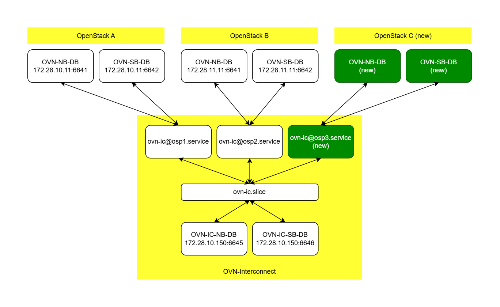
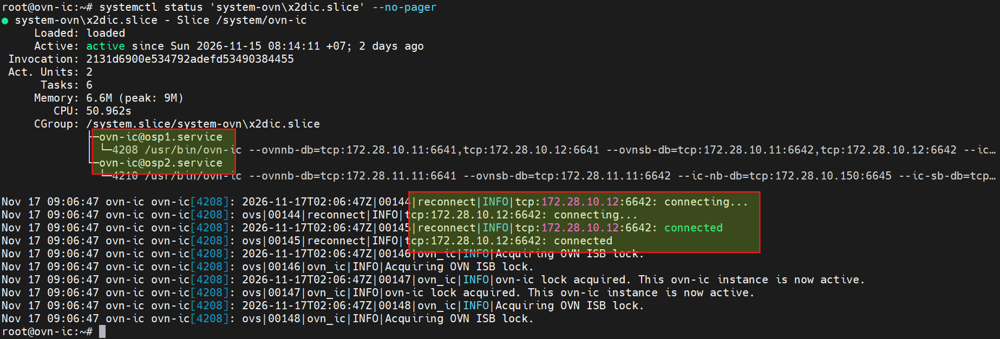
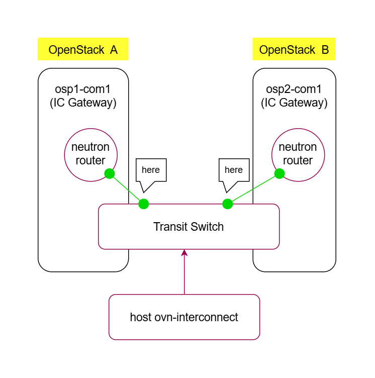
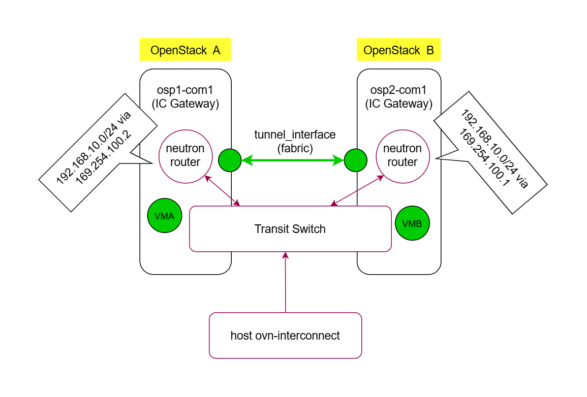
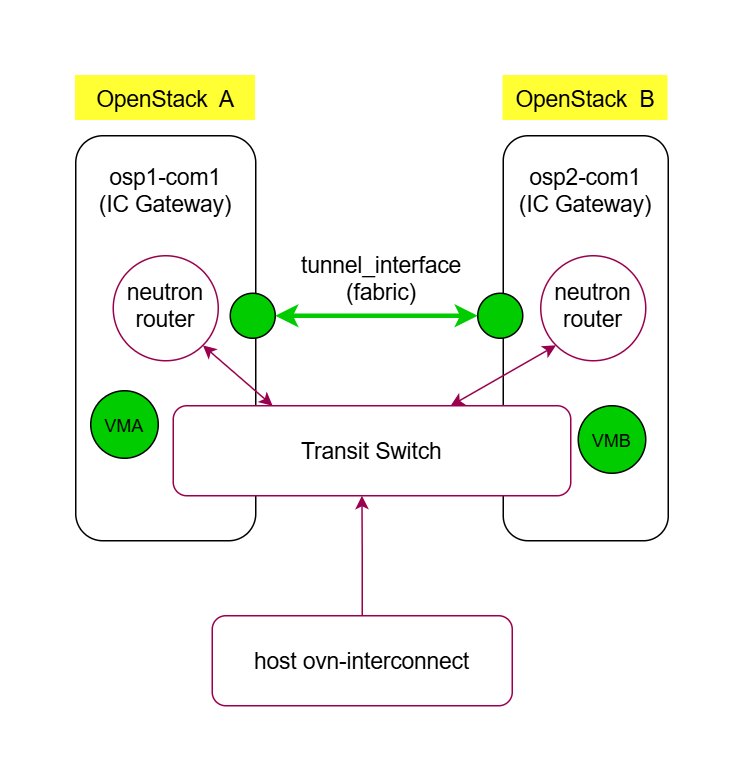
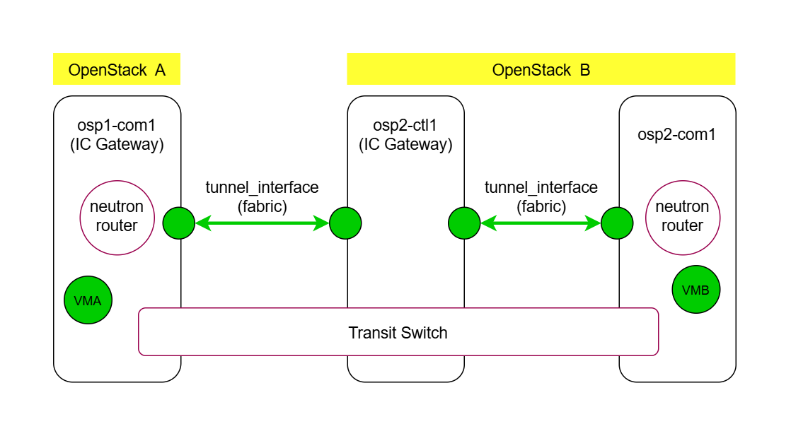

# Nghiên cứu triển khai OVN Interconnect

## Khởi động OVN-Interconnect

### Chuẩn bị



Tạo 3 file sau:

1. File nền tảng: /etc/systemd/system/ovn-ic@.service
2. File dành cho osp1: /etc/default/ovn-ic-osp1
3. File dành cho osp2: /etc/default/ovn-ic-osp2

```bash
root@ovn-ic:/etc/systemd/system# cat ovn-ic@.service
[Unit]
Description=OVN Interconnection controller for %i
After=network-online.target ovn-ovsdb-server-ic-nb.service ovn-ovsdb-server-ic-sb.service
Wants=network-online.target

[Service]
Type=simple
EnvironmentFile=/etc/default/ovn-ic-%i
ExecStart=/usr/bin/ovn-ic \
  --ovnnb-db=${OVNNB_DB} \
  --ovnsb-db=${OVNSB_DB} \
  --ic-nb-db=${IC_NB_DB} \
  --ic-sb-db=${IC_SB_DB} \
  --unixctl=/run/ovn/ovn-ic-%i.ctl \
  --log-file=/var/log/ovn/ovn-ic-%i.log
Restart=on-failure
RestartSec=2

[Install]
WantedBy=multi-user.target
root@ovn-ic:/etc/systemd/system#
```

```bash
root@ovn-ic:~# cat /etc/default/ovn-ic-osp1
OVNNB_DB=tcp:172.28.10.11:6641,tcp:172.28.10.12:6641
OVNSB_DB=tcp:172.28.10.11:6642,tcp:172.28.10.12:6642
IC_NB_DB=tcp:172.28.10.150:6645
IC_SB_DB=tcp:172.28.10.150:6646
root@ovn-ic:~#
```

```bash
root@ovn-ic:~# cat /etc/default/ovn-ic-osp2
OVNNB_DB=tcp:172.28.11.11:6641
OVNSB_DB=tcp:172.28.11.11:6642
IC_NB_DB=tcp:172.28.10.150:6645
IC_SB_DB=tcp:172.28.10.150:6646
root@ovn-ic:~#
```

### Khởi chạy và nghiệm thu

Khởi động OVN-IC:

```bash
$ systemctl daemon-reload
```

```bash
$ systemctl enable --now ovn-ic@osp1.service
$ systemctl enable --now ovn-ic@osp2.service
```

Nghiệm thu kết quả:



```bash
root@ovn-ic:~# systemctl status system-ovn\\x2dic.slice
● system-ovn\x2dic.slice - Slice /system/ovn-ic
     Loaded: loaded
     Active: active since Sun 2026-11-15 08:14:11 +07; 2 days ago
 Invocation: 2131d6900e534792adefd53490384455
 Act. Units: 2
      Tasks: 6
     Memory: 6.6M (peak: 9M)
        CPU: 50.907s
     CGroup: /system.slice/system-ovn\x2dic.slice
             ├─ovn-ic@osp1.service
             │ └─4208 /usr/bin/ovn-ic --ovnnb-db=tcp:172.28.10.11:6641,tcp:172.28.10.12:6641 --ovnsb-db=tcp:172.28.10.11:6642,tcp:172.28.10.12:6642 --ic-nb-db=tcp:172.28.10.150:6645 --ic-sb-db=tcp:172.28.>
             └─ovn-ic@osp2.service
               └─4210 /usr/bin/ovn-ic --ovnnb-db=tcp:172.28.11.11:6641 --ovnsb-db=tcp:172.28.11.11:6642 --ic-nb-db=tcp:172.28.10.150:6645 --ic-sb-db=tcp:172.28.10.150:6646 --unixctl=/run/ovn/ovn-ic-osp2.c>

Nov 17 09:06:47 ovn-ic ovn-ic[4208]: 2026-11-17T02:06:47Z|00144|reconnect|INFO|tcp:172.28.10.12:6642: connecting...
Nov 17 09:06:47 ovn-ic ovn-ic[4208]: ovs|00144|reconnect|INFO|tcp:172.28.10.12:6642: connecting...
Nov 17 09:06:47 ovn-ic ovn-ic[4208]: 2026-11-17T02:06:47Z|00145|reconnect|INFO|tcp:172.28.10.12:6642: connected
Nov 17 09:06:47 ovn-ic ovn-ic[4208]: ovs|00145|reconnect|INFO|tcp:172.28.10.12:6642: connected
Nov 17 09:06:47 ovn-ic ovn-ic[4208]: 2026-11-17T02:06:47Z|00146|ovn_ic|INFO|Acquiring OVN ISB lock.
Nov 17 09:06:47 ovn-ic ovn-ic[4208]: ovs|00146|ovn_ic|INFO|Acquiring OVN ISB lock.
Nov 17 09:06:47 ovn-ic ovn-ic[4208]: 2026-11-17T02:06:47Z|00147|ovn_ic|INFO|ovn-ic lock acquired. This ovn-ic instance is now active.
Nov 17 09:06:47 ovn-ic ovn-ic[4208]: ovs|00147|ovn_ic|INFO|ovn-ic lock acquired. This ovn-ic instance is now active.
Nov 17 09:06:47 ovn-ic ovn-ic[4208]: 2026-11-17T02:06:47Z|00148|ovn_ic|INFO|Acquiring OVN ISB lock.
Nov 17 09:06:47 ovn-ic ovn-ic[4208]: ovs|00148|ovn_ic|INFO|Acquiring OVN ISB lock.
root@ovn-ic:~#
```

## Triển khai Transit Switch

### Tạo Transit Switch

Tại node OVN-IC thực hiện tạo Transit Switch như sau:

```
root@ovn-ic:~# ovn-ic-nbctl --wait=sb ts-add my-transit-switch
root@ovn-ic:~# ovn-ic-nbctl --wait=sb ts-list
d529ef21-87b2-408b-9e63-415c432edd64 (my-transit-switch)
ceb9ad9a-9055-4899-8df2-378c26f63b08 (ts-interconnect)
root@ovn-ic:~#
```

### Xác minh

Tại node osp1 kiểm tra thấy được thông tin Transit Switch vừa tạo

```bash
root@osp1-ctl1:~# docker exec -it -u0 ovn_nb_db ovn-nbctl --no-leader-only find Logical_Switch other_config:interconn-ts=my-transit-switch
_uuid               : e4f46019-4988-4267-8294-036eb9a37219
acls                : []
copp                : []
dns_records         : []
external_ids        : {}
forwarding_groups   : []
load_balancer       : []
load_balancer_group : []
name                : my-transit-switch
other_config        : {ic-vxlan_mode="false", interconn-ts=my-transit-switch, requested-tnl-key="16711683"}
ports               : []
qos_rules           : []
root@osp1-ctl1:~#
```

, tương tự với osp2:

```bash
root@osp2-ctl1:~# docker exec -it -u0 ovn_nb_db ovn-nbctl --no-leader-only find Logical_Switch other_config:interconn-ts=my-transit-switch
_uuid               : d3ebc6a9-2a64-488b-ad4f-15ecfbceae1d
acls                : []
copp                : []
dns_records         : []
external_ids        : {}
forwarding_groups   : []
load_balancer       : []
load_balancer_group : []
name                : my-transit-switch
other_config        : {ic-vxlan_mode="false", interconn-ts=my-transit-switch, requested-tnl-key="16711683"}
ports               : []
qos_rules           : []
root@osp2-ctl1:~#
```

### Chuẩn bị network geneve

#### OSP1 tạo network geneve

Truy vấn thông qua OpenStack CLI có được thông tin như sau:

```bash
$ openstack network show -f yaml osp1-lan
admin_state_up: true
availability_zone_hints: []
availability_zones: []
created_at: '2026-11-17T09:36:21Z'
description: ''
dns_domain: null
id: 66e2aa6a-7489-474d-a871-36a36d4a1a39
ipv4_address_scope: null
ipv6_address_scope: null
is_default: null
is_vlan_qinq: null
is_vlan_transparent: false
mtu: 1442
name: osp1-lan
port_security_enabled: true
project_id: 5d44251440b84d23a1411d83dfbe1f30
provider:network_type: geneve
provider:physical_network: null
provider:segmentation_id: 1840
pvlan: null
qinq: false
qos_policy_id: null
revision_number: 2
router:external: false
segments: null
shared: false
status: ACTIVE
subnets:
- 529c7ad7-3a23-4f5d-8517-9a5ef0857cf9
tags: []
updated_at: '2026-11-17T09:36:21Z'
```

```bash
$ openstack subnet show -f yaml 529c7ad7-3a23-4f5d-8517-9a5ef0857cf9
allocation_pools:
- end: 192.168.10.254
  start: 192.168.10.2
cidr: 192.168.10.0/24
created_at: '2026-11-17T09:36:21Z'
description: ''
dns_nameservers:
- 8.8.8.8
dns_publish_fixed_ip: null
enable_dhcp: true
gateway_ip: 192.168.10.1
host_routes: []
id: 529c7ad7-3a23-4f5d-8517-9a5ef0857cf9
ip_version: 4
ipv6_address_mode: null
ipv6_ra_mode: null
name: ''
network_id: 66e2aa6a-7489-474d-a871-36a36d4a1a39
project_id: 5d44251440b84d23a1411d83dfbe1f30
revision_number: 0
router:external: false
segment_id: null
service_types: []
subnetpool_id: null
tags: []
updated_at: '2026-11-17T09:36:21Z'
```

Truy vấn thông qua OVN NB có được thông tin network như sau:

```bash
root@osp1-ctl1:~# docker exec -it -u0 ovn_nb_db ovn-nbctl --no-leader-only list logical_switch neutron-66e2aa6a-7489-474d-a871-36a36d4a1a39
_uuid               : 66e2aa6a-7489-474d-a871-36a36d4a1a39
acls                : []
copp                : []
dns_records         : []
external_ids        : {"neutron:availability_zone_hints"="", "neutron:mtu"="1442", "neutron:network_name"=osp1-lan, "neutron:provnet-network-type"=geneve, "neutron:revision_number"="2"}
forwarding_groups   : []
load_balancer       : []
load_balancer_group : []
name                : neutron-66e2aa6a-7489-474d-a871-36a36d4a1a39
other_config        : {mcast_flood_unregistered="false", mcast_snoop="false", vlan-passthru="false"}
ports               : [2fec15c9-c7ee-4590-bc2c-375d0f3cabaa, bcf09665-e3c4-4239-adfa-3e12c6a538b6, e5b9710b-8fe8-4d60-9e4d-b5358fcbfbda]
qos_rules           : []
root@osp1-ctl1:~#
```

#### OSP2 tạo network geneve

```bash
$ openstack network show -f yaml osp2-lan
admin_state_up: true
availability_zone_hints: []
availability_zones: []
created_at: '2026-11-17T09:35:24Z'
description: ''
dns_domain: null
id: a157097c-75ff-4b72-9922-4536a6fbd662
ipv4_address_scope: null
ipv6_address_scope: null
is_default: null
is_vlan_qinq: null
is_vlan_transparent: false
mtu: 1442
name: osp2-lan
port_security_enabled: true
project_id: 934f7645f6a446f29439eb17d56fdcb1
provider:network_type: geneve
provider:physical_network: null
provider:segmentation_id: 1043
pvlan: null
qinq: false
qos_policy_id: null
revision_number: 2
router:external: false
segments: null
shared: false
status: ACTIVE
subnets:
- 828f70c7-1188-40a0-8274-feb082b5d357
tags: []
updated_at: '2026-11-17T09:35:25Z'
```

```bash
$ openstack subnet show -f yaml 828f70c7-1188-40a0-8274-feb082b5d357
allocation_pools:
- end: 192.168.20.254
  start: 192.168.20.2
cidr: 192.168.20.0/24
created_at: '2026-11-17T09:35:25Z'
description: ''
dns_nameservers:
- 8.8.8.8
dns_publish_fixed_ip: null
enable_dhcp: true
gateway_ip: 192.168.20.1
host_routes: []
id: 828f70c7-1188-40a0-8274-feb082b5d357
ip_version: 4
ipv6_address_mode: null
ipv6_ra_mode: null
name: ''
network_id: a157097c-75ff-4b72-9922-4536a6fbd662
project_id: 934f7645f6a446f29439eb17d56fdcb1
revision_number: 0
router:external: false
segment_id: null
service_types: []
subnetpool_id: null
tags: []
updated_at: '2026-11-17T09:35:25Z'
```

Truy vấn thông qua OVN NB có được thông tin network như sau:

```bash
root@osp2-ctl1:~# docker exec -it -u0 ovn_nb_db ovn-nbctl --no-leader-only list logical_switch neutron-a157097c-75ff-4b72-9922-4536a6fbd662
_uuid               : a157097c-75ff-4b72-9922-4536a6fbd662
acls                : []
copp                : []
dns_records         : []
external_ids        : {"neutron:availability_zone_hints"="", "neutron:mtu"="1442", "neutron:network_name"=osp2-lan, "neutron:provnet-network-type"=geneve, "neutron:revision_number"="2"}
forwarding_groups   : []
load_balancer       : []
load_balancer_group : []
name                : neutron-a157097c-75ff-4b72-9922-4536a6fbd662
other_config        : {mcast_flood_unregistered="false", mcast_snoop="false", vlan-passthru="false"}
ports               : [17992040-1294-47c9-96df-a6801208673b, 2cea8854-6992-470d-b4da-5ae1bb4ae353, fb2f795e-bf76-4f87-be5c-8e43f33d0dfc]
qos_rules           : []
root@osp2-ctl1:~#
```

### Chuẩn bị logical router

#### OSP1 tạo logical router

Truy vấn thông qua OpenStack CLI có được thông tin như sau:

```bash
$ openstack router show -f yaml osp1-router
admin_state_up: true
availability_zone_hints: []
availability_zones: []
created_at: '2026-11-17T09:50:25Z'
description: ''
enable_default_route_bfd: false
enable_default_route_ecmp: false
enable_ndp_proxy: null
enable_snat: true
external_gateway_info: null
external_gateways: []
flavor_id: null
ha: true
id: 76b2099f-6fc7-4ba0-a06b-7800f4e8533c
interfaces_info:
- ip_address: 192.168.10.1
  port_id: 737095e0-1c55-4ab7-9fba-36415060f81e
  subnet_id: 529c7ad7-3a23-4f5d-8517-9a5ef0857cf9
name: osp1-router
project_id: 5d44251440b84d23a1411d83dfbe1f30
revision_number: 2
routes: []
status: ACTIVE
tags: []
updated_at: '2026-11-17T09:50:49Z'
```

```
openstack port list -f yaml --router osp1-router
- Fixed IP Addresses:
  - ip_address: 192.168.10.1
    subnet_id: 529c7ad7-3a23-4f5d-8517-9a5ef0857cf9
  ID: 737095e0-1c55-4ab7-9fba-36415060f81e
  MAC Address: fa:16:3e:8e:c1:15
  Name: ''
  Status: ACTIVE
```

Truy vấn thông qua OVN NB có được thông tin như sau:

```bash
root@osp1-ctl1:~# docker exec -it -u0 ovn_nb_db ovn-nbctl --no-leader-only list logical_router neutron-76b2099f-6fc7-4ba0-a06b-7800f4e8533c
_uuid               : 03d5a3fd-f54e-4779-b774-c6a200f4da7c
copp                : []
enabled             : true
external_ids        : {"neutron:availability_zone_hints"="", "neutron:revision_number"="1", "neutron:router_name"=osp1-router}
load_balancer       : []
load_balancer_group : []
name                : neutron-76b2099f-6fc7-4ba0-a06b-7800f4e8533c
nat                 : []
options             : {always_learn_from_arp_request="false", dynamic_neigh_routers="true", mac_binding_age_threshold="0"}
policies            : []
ports               : [e1dd6242-de4d-41d2-aa2f-63f3d1369661]
static_routes       : []
root@osp1-ctl1:~#
root@osp1-ctl1:~#
```

```bash
root@osp1-ctl1:~# docker exec -it -u0 ovn_nb_db ovn-nbctl --no-leader-only lrp-list neutron-76b2099f-6fc7-4ba0-a06b-7800f4e8533c
e1dd6242-de4d-41d2-aa2f-63f3d1369661 (lrp-737095e0-1c55-4ab7-9fba-36415060f81e)
root@osp1-ctl1:~#
```

Tạo 1 port tại router để kết nối đến Transit Switch:

```bash
root@osp1-ctl1:~# docker exec -it -u0 ovn_nb_db ovn-nbctl --no-leader-only lrp-add neutron-76b2099f-6fc7-4ba0-a06b-7800f4e8533c   lrp-osp1-to-switch-transit   02:00:00:00:01:01   169.254.100.1/24
root@osp1-ctl1:~# docker exec -it -u0 ovn_nb_db ovn-nbctl --no-leader-only lrp-list neutron-76b2099f-6fc7-4ba0-a06b-7800f4e8533c
e1dd6242-de4d-41d2-aa2f-63f3d1369661 (lrp-737095e0-1c55-4ab7-9fba-36415060f81e)
57b8bfa3-6c65-4195-9fdd-a01b018e230c (lrp-osp1-to-switch-transit)
root@osp1-ctl1:~#
```

#### OSP2 tạo logical router

```bash
$ openstack router show -f yaml osp2-router
admin_state_up: true
availability_zone_hints: []
availability_zones: []
created_at: '2026-11-17T09:50:37Z'
description: ''
enable_default_route_bfd: false
enable_default_route_ecmp: false
enable_ndp_proxy: null
enable_snat: true
external_gateway_info: null
external_gateways: []
flavor_id: null
ha: true
id: e49c2bdf-2dbd-4235-b071-c41a2bf60a24
interfaces_info:
- ip_address: 192.168.20.1
  port_id: 0a8d36c9-98a8-46fb-8bce-80764958cc8c
  subnet_id: 828f70c7-1188-40a0-8274-feb082b5d357
name: osp2-router
project_id: 934f7645f6a446f29439eb17d56fdcb1
revision_number: 2
routes: []
status: ACTIVE
tags: []
updated_at: '2026-11-17T09:50:55Z'
```

```bash
openstack port list -f yaml --router osp2-router
- Fixed IP Addresses:
  - ip_address: 192.168.20.1
    subnet_id: 828f70c7-1188-40a0-8274-feb082b5d357
  ID: 0a8d36c9-98a8-46fb-8bce-80764958cc8c
  MAC Address: fa:16:3e:b3:12:56
  Name: ''
  Status: ACTIVE
```

Truy vấn thông tin OVN NB có được như sau:

```bash
root@osp2-ctl1:~# docker exec -it -u0 ovn_nb_db ovn-nbctl --no-leader-only list logical_router neutron-e49c2bdf-2dbd-4235-b071-c41a2bf60a24
_uuid               : af172abf-e87f-4881-a8c1-15a7763074a7
copp                : []
enabled             : true
external_ids        : {"neutron:availability_zone_hints"="", "neutron:revision_number"="2", "neutron:router_name"=osp2-router}
load_balancer       : []
load_balancer_group : []
name                : neutron-e49c2bdf-2dbd-4235-b071-c41a2bf60a24
nat                 : []
options             : {always_learn_from_arp_request="false", dynamic_neigh_routers="true", mac_binding_age_threshold="0"}
policies            : []
ports               : [dec2fb39-db7b-4ed9-94e1-0c996180b634]
static_routes       : []
```

```bash
root@osp2-ctl1:~# docker exec -it -u0 ovn_nb_db ovn-nbctl --no-leader-only lrp-list neutron-e49c2bdf-2dbd-4235-b071-c41a2bf60a24
dec2fb39-db7b-4ed9-94e1-0c996180b634 (lrp-0a8d36c9-98a8-46fb-8bce-80764958cc8c)
root@osp2-ctl1:~#
```

Tạo 1 port tại router để kết nối đến Transit Switch:

```bash
root@osp2-ctl1:~# docker exec -it -u0 ovn_nb_db ovn-nbctl lrp-add neutron-e49c2bdf-2dbd-4235-b071-c41a2bf60a24 \
  lrp-osp2-to-switch-transit \
  02:00:00:00:02:01 \
  169.254.100.2/24
root@osp2-ctl1:~#
root@osp2-ctl1:~# docker exec -it -u0 ovn_nb_db ovn-nbctl --no-leader-only lrp-list neutron-e49c2bdf-2dbd-4235-b071-c41a2bf60a24
dec2fb39-db7b-4ed9-94e1-0c996180b634 (lrp-0a8d36c9-98a8-46fb-8bce-80764958cc8c)
9042af2d-8ed5-4faf-bea8-c5f0ce43d19b (lrp-osp2-to-switch-transit)
root@osp2-ctl1:~#
```

### Tạo peer port từ giữa Transit Switch và Logical Router



#### Tạo peer port từ OSP1 đến Transit Switch

```bash
root@osp1-ctl1:~# docker exec -it -u0 ovn_nb_db ovn-nbctl --no-leader-only lsp-add \
my-transit-switch lsp-osp1-transit-switch \
-- set Logical_Switch_Port lsp-osp1-transit-switch \
	type=router \
    options:router-port=lrp-osp1-to-switch-transit \
    addresses=router
root@osp1-ctl1:~# docker exec -it -u0 ovn_nb_db ovn-nbctl --no-leader-only lrp-list \
neutron-76b2099f-6fc7-4ba0-a06b-7800f4e8533c
e1dd6242-de4d-41d2-aa2f-63f3d1369661 (lrp-737095e0-1c55-4ab7-9fba-36415060f81e)
57b8bfa3-6c65-4195-9fdd-a01b018e230c (lrp-osp1-to-switch-transit)
root@osp1-ctl1:~#
```

Kiểm tra kết quả tại OSP1

```bash
root@osp1-ctl1:~# docker exec -it -u0 ovn_nb_db ovn-nbctl show | grep -A10 osp1-router
router 03d5a3fd-f54e-4779-b774-c6a200f4da7c (neutron-76b2099f-6fc7-4ba0-a06b-7800f4e8533c) (aka osp1-router)
    port lrp-osp1-to-switch-transit
        mac: "02:00:00:00:01:01"
        ipv6-lla: "fe80::ff:fe00:101"
        networks: ["169.254.100.1/24"]
    port lrp-737095e0-1c55-4ab7-9fba-36415060f81e
        mac: "fa:16:3e:8e:c1:15"
        ipv6-lla: "fe80::f816:3eff:fe8e:c115"
        networks: ["192.168.10.1/24"]
root@osp1-ctl1:~#
```

```bash
root@osp1-ctl1:~# docker exec -it -u0 ovn_nb_db ovn-nbctl show | grep -A10 osp1-lan
switch 66e2aa6a-7489-474d-a871-36a36d4a1a39 (neutron-66e2aa6a-7489-474d-a871-36a36d4a1a39) (aka osp1-lan)
    port 737095e0-1c55-4ab7-9fba-36415060f81e
        type: router
        router-port: lrp-737095e0-1c55-4ab7-9fba-36415060f81e
    port 030cba1c-dee9-4a50-ae93-3030e89482be
        addresses: ["fa:16:3e:36:36:fd 192.168.10.148"]
    port d1cd5a89-e18f-4f97-924c-0b0c9e3fbca4
        type: localport
        addresses: ["fa:16:3e:da:2b:94 192.168.10.2"]
switch 17360d82-e0c6-4217-8f93-a7f48797b978 (neutron-17360d82-e0c6-4217-8f93-a7f48797b978) (aka my-lan3)
    port 971027b5-8e38-44bf-8a77-127ed172a900
root@osp1-ctl1:~#
```

#### Tạo peer port từ OSP2 đến Transit Switch

```bash
root@osp2-ctl1:~# docker exec -it -u0 ovn_nb_db ovn-nbctl --no-leader-only lsp-add \
my-transit-switch lsp-osp2-transit-switch \
-- set Logical_Switch_Port lsp-osp2-transit-switch \
    type=router \
    options:router-port=lrp-osp2-to-switch-transit \
    addresses=router
root@osp2-ctl1:~#
root@osp2-ctl1:~#
root@osp2-ctl1:~# docker exec -it -u0 ovn_nb_db ovn-nbctl --no-leader-only lsp-list my-transit-switch
f6002eec-b4de-4390-87f9-8c261929316f (lsp-osp1-transit-switch)
8423e0a5-43bf-4f75-b618-54208308ea3c (lsp-osp2-transit-switch)
root@osp2-ctl1:~#
```

Kiểm tra kết quả tại OSP2:

```bash
root@osp2-ctl1:~# docker exec -it -u0 ovn_nb_db ovn-nbctl show | grep -A10 osp2-router
router af172abf-e87f-4881-a8c1-15a7763074a7 (neutron-e49c2bdf-2dbd-4235-b071-c41a2bf60a24) (aka osp2-router)
    port lrp-osp2-to-switch-transit
        mac: "02:00:00:00:02:01"
        ipv6-lla: "fe80::ff:fe00:201"
        networks: ["169.254.100.2/24"]
    port lrp-0a8d36c9-98a8-46fb-8bce-80764958cc8c
        mac: "fa:16:3e:b3:12:56"
        ipv6-lla: "fe80::f816:3eff:feb3:1256"
        networks: ["192.168.20.1/24"]
root@osp2-ctl1:~#
```

```bash
root@osp2-ctl1:~# docker exec -it -u0 ovn_nb_db ovn-nbctl show | grep -A10 osp2-lan
switch a157097c-75ff-4b72-9922-4536a6fbd662 (neutron-a157097c-75ff-4b72-9922-4536a6fbd662) (aka osp2-lan)
    port 44339764-41bd-467c-8f60-ea209701d89a
        addresses: ["fa:16:3e:cb:e3:86 192.168.20.35"]
    port 0a8d36c9-98a8-46fb-8bce-80764958cc8c
        type: router
        router-port: lrp-0a8d36c9-98a8-46fb-8bce-80764958cc8c
    port 67c1ddca-b626-4406-b1a1-79e4b1dfc7c4
        type: localport
        addresses: ["fa:16:3e:d8:67:ad 192.168.20.2"]
switch 667b07ac-9279-466a-a435-1ed29475bf58 (neutron-667b07ac-9279-466a-a435-1ed29475bf58) (aka public-network1)
    port 56352c55-3435-4f7a-9b72-a2b4c5acc4d0
root@osp2-ctl1:~#
```

### Chuẩn bị static route đối xứng



#### Tạo static route từ OSP1 đến OSP2

```bash
root@osp1-ctl1:~# docker exec -it -u0 ovn_nb_db ovn-nbctl --no-leader-only lr-route-add \
neutron-76b2099f-6fc7-4ba0-a06b-7800f4e8533c   192.168.20.0/24   169.254.100.2
```

```bash
root@osp1-ctl1:~# docker exec -it -u0 ovn_nb_db ovn-nbctl --no-leader-only lr-route-list neutron-76b2099f-6fc7-4ba0-a06b-7800f4e8533c
IPv4 Routes
Route Table <main>:
          192.168.20.0/24             169.254.100.2 dst-ip
root@osp1-ctl1:~#
```

#### Tạo static route từ OSP2 đến OSP1

```bash
root@osp2-ctl1:~# docker exec -it -u0 ovn_nb_db ovn-nbctl lr-route-add \
neutron-e49c2bdf-2dbd-4235-b071-c41a2bf60a24   192.168.10.0/24   169.254.100.1
```

```bash
root@osp2-ctl1:~# docker exec -it -u0 ovn_nb_db ovn-nbctl lr-route-list neutron-e49c2bdf-2dbd-4235-b071-c41a2bf60a24
IPv4 Routes
Route Table <main>:
          192.168.10.0/24             169.254.100.1 dst-ip
root@osp2-ctl1:~#
```

### Triển khai mô hình thông compute đến compute

#### Compute (IC GW) đến Compute (IC GW)



Thông tin rỗng tức là chưa có node nào đăng ký làm Interconnect Gateway:

```
root@ovn-ic:~# ovn-ic-sbctl show
availability-zone osp1-rg1
availability-zone osp2-rg1
root@ovn-ic:~#
```

Đăng ký trở thành IC Gateway:

```bash
root@osp1-com1:~# docker exec -it -u0 openvswitch_vswitchd ovs-vsctl set open . external_ids:ovn-is-interconn=true
```

```bash
root@osp1-com1:~# docker exec -it -u0 openvswitch_vswitchd ovs-vsctl get open . external_ids
{hostname=osp1-com1, ovn-bridge-mappings="physnet1:br-ex", ovn-chassis-mac-mappings="physnet1:52:54:00:d3:ea:c4", ovn-encap-ip="172.28.20.21", ovn-encap-type=geneve, ovn-is-interconn="true", ovn-monitor-all="false", ovn-openflow-probe-interval="60", ovn-remote="tcp:172.28.10.11:16641,tcp:172.28.10.12:16641", ovn-remote-probe-interval="60000", system-id=osp1-com1}
root@osp1-com1:~#
```

Kiểm tra nếu không thấy local datapath (Transit Switch)

```bash
root@osp1-com1:~# docker exec -u0 ovn_controller ovs-appctl -t /run/ovn/ovn-controller.7.ctl debug/dump-local-datapaths
Local datapaths:
Datapath: neutron-66e2aa6a-7489-474d-a871-36a36d4a1a39, type: switch
Datapath: neutron-76b2099f-6fc7-4ba0-a06b-7800f4e8533c, type: router
Datapath: neutron-bf85477e-1b4f-4b4f-a754-a7dda452db58, type: switch
Datapath: neutron-0ea1ba5e-597b-4888-b4bf-197f0cb2224e, type: router
Datapath: my-transit-switch, type: switch
Datapath: neutron-f9a4ddf8-a33c-4cd7-ace7-51a82dde4383, type: switch
Datapath: neutron-8e23aa2b-ad52-4416-8d85-6c825d289a4c, type: router
Datapath: neutron-5ab24903-b867-494a-9553-91a1574d035a, type: switch
root@osp1-com1:~#
```

```bash
root@osp1-ctl1:~# docker exec ovn_nb_db ovn-nbctl --no-leader-only lrp-set-gateway-chassis \
lrp-osp1-to-switch-transit osp1-com1 1
```

```bash
root@osp1-ctl1:~# docker exec ovn_nb_db ovn-nbctl --no-leader-only lrp-get-gateway-chassis \
lrp-osp1-to-switch-transit
lrp-osp1-to-switch-transit-osp1-com1     1
root@osp1-ctl1:~#
```

Đăng ký trở thành IC Gateway:

```bash
root@osp2-com1:~# docker exec -it -u0 openvswitch_vswitchd ovs-vsctl set open . external_ids:ovn-is-interconn=true
```

```bash
root@osp2-com1:~# docker exec -it -u0 openvswitch_vswitchd ovs-vsctl get open . external_ids
{hostname=osp2-com1, ovn-bridge-mappings="physnet1:br-ex", ovn-chassis-mac-mappings="physnet1:52:54:00:24:96:f4", ovn-encap-ip="172.28.21.21", ovn-encap-type=geneve, ovn-is-interconn="true", ovn-monitor-all="false", ovn-openflow-probe-interval="60", ovn-remote="tcp:172.28.11.11:16641", ovn-remote-probe-interval="60000", system-id=osp2-com1}
root@osp2-com1:~#
```

Kiểm tra local datapath (Transit Switch) trên compute node

```bash
root@osp2-com1:~#  docker exec -u0 ovn_controller   ovs-appctl -t /run/ovn/ovn-controller.7.ctl   debug/dump-local-datapaths
Local datapaths:
Datapath: neutron-a157097c-75ff-4b72-9922-4536a6fbd662, type: switch
Datapath: neutron-71bb20af-f9ae-4c8a-960e-e6556ba43f9d, type: switch
Datapath: neutron-e49c2bdf-2dbd-4235-b071-c41a2bf60a24, type: router
Datapath: neutron-dce6198f-3d42-4b00-9788-e3542c3a8705, type: router
Datapath: my-transit-switch, type: switch
root@osp2-com1:~#
```

```bash
root@osp2-ctl1:~# docker exec ovn_nb_db ovn-nbctl --no-leader-only lrp-set-gateway-chassis \
lrp-osp2-to-switch-transit osp2-com1 1
```

```bash
root@osp2-ctl1:~# docker exec ovn_nb_db ovn-nbctl --no-leader-only lrp-get-gateway-chassis \
lrp-osp2-to-switch-transit
lrp-osp2-to-switch-transit-osp2-com1     1
root@osp2-ctl1:~#
```

Đã có 2 node trở thành Interconnect Gateway:

```bash
root@ovn-ic:~# ovn-ic-sbctl show
availability-zone osp1-rg1
    gateway osp1-com1
        hostname: osp1-com1
        type: geneve
            ip: 172.28.20.21
        port lsp-osp1-transit-switch
            transit switch: my-transit-switch
            address: ["02:00:00:00:01:01 169.254.100.1/24"]
availability-zone osp2-rg1
    gateway osp2-com1
        hostname: osp2-com1
        type: geneve
            ip: 172.28.21.21
        port lsp-osp2-transit-switch
            transit switch: my-transit-switch
            address: ["02:00:00:00:02:01 169.254.100.2/24"]
root@ovn-ic:~#
```

#### ComputeA (IC GW) đến NetworkB (IC GW), ComputeB



Chuyển IC GW từ compute node sang network node

```bash
root@osp2-com1:~# docker exec -it -u0 openvswitch_vswitchd ovs-vsctl remove Open_vSwitch . external_ids ovn-is-interconn
root@osp2-com1:~#
```

```bash
root@osp2-ctl1:~# docker exec -it -u0 openvswitch_vswitchd ovs-vsctl set open . external_ids:ovn-is-interconn=true
root@osp2-ctl1:~#
```

```bash
root@osp2-ctl1:~# docker exec -it -u0 openvswitch_vswitchd ovs-vsctl get open . external_ids
{hostname=osp2-ctl1, ovn-bridge-mappings="physnet1:br-ex", ovn-cms-options=enable-chassis-as-gw, ovn-encap-ip="172.28.21.11", ovn-encap-type=geneve, ovn-is-interconn="true", ovn-monitor-all="false", ovn-openflow-probe-interval="60", ovn-remote="tcp:172.28.11.11:16641", ovn-remote-probe-interval="60000", system-id=osp2-ctl1}
root@osp2-ctl1:~#
root@osp2-ctl1:~# docker exec ovn_nb_db ovn-nbctl --no-leader-only \
lrp-get-gateway-chassis \
lrp-osp2-to-switch-transit lrp-osp2-to-switch-transit-osp2-ctl1     1
root@osp2-ctl1:~#
```

Kiểm tra local datapath (Transit Switch) trên network node

```bash
root@osp2-ctl1:~# docker exec -u0 ovn_controller  ovs-appctl -t /run/ovn/ovn-controller.7.ctl  debug/dump-local-datapaths
Local datapaths:
Datapath: neutron-a157097c-75ff-4b72-9922-4536a6fbd662, type: switch
Datapath: neutron-667b07ac-9279-466a-a435-1ed29475bf58, type: switch
Datapath: neutron-e49c2bdf-2dbd-4235-b071-c41a2bf60a24, type: router
Datapath: neutron-71bb20af-f9ae-4c8a-960e-e6556ba43f9d, type: switch
Datapath: my-transit-switch, type: switch
Datapath: neutron-dce6198f-3d42-4b00-9788-e3542c3a8705, type: router
root@osp2-ctl1:~#
```

Trên OVN-IC đã thấy thay đổi IC GW sang network node

```bash
root@ovn-ic:~# ovn-ic-sbctl show
availability-zone osp1-rg1
    gateway osp1-com1
        hostname: osp1-com1
        type: geneve
            ip: 172.28.20.21
        port lsp-osp1-transit-switch
            transit switch: my-transit-switch
            address: ["02:00:00:00:01:01 169.254.100.1/24"]
availability-zone osp2-rg1
    gateway osp2-ctl1
        hostname: osp2-ctl1
        type: geneve
            ip: 172.28.21.11
        port lsp-osp2-transit-switch
            transit switch: my-transit-switch
            address: ["02:00:00:00:02:01 169.254.100.2/24"]
root@ovn-ic:~#
```
